# Relay — reply debt, cleared

**Telegram, reduced to the few people actually waiting on you — read at a glance, answered by voice, sent with one tap on Even G2.**

[](https://github.com/bolajiev/relay-g2/actions/workflows/ci.yml)

[Team one-pager](TEAM.md) · [Watch the 66-second demo with voice-over](https://github.com/bolajiev/relay-g2/releases/download/v0.1.0/relay-demo.mp4) · [Pairing page screenshot](docs/pair-page.png) · [Packaged build](https://github.com/bolajiev/relay-g2/releases/download/v0.1.0/relay.ehpk) · [Source](https://github.com/bolajiev/relay-g2)

<a href="https://github.com/bolajiev/relay-g2/releases/download/v0.1.0/relay-demo.mp4">
  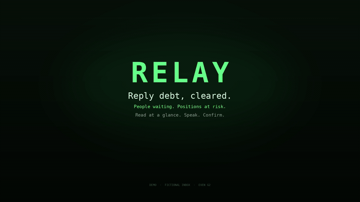
</a>

*66-second demo, voice-over + captions. The inline GIF is silent; click it for the MP4 with audio and controls.*

---

## The problem

A phone full of unread messages is not an inbox problem; it is a **decision problem**. On smart glasses, a notification mirror is worse than the phone: it gives you 50 things you cannot act on.

Relay is an **anti-inbox**. It reads your Telegram threads, keeps only the ones where the last message is inbound and something is actually being asked of you, extracts **the ask**, and puts the top few on the glasses. Then it closes them:

1. **Read** — `Ana Ruiz — Send latest deck before design review at 5`
2. **Tap** — `NEEDS: Send latest deck before design review at 5` + a draft
3. **Hold the ring, speak badly** — *"yeah tell her I'll send it by 4:30"*
4. **Release** — `DRAFT → Ana: Yes — I'll send it by 4:30.`
5. **Tap** — `Sent. 4 left.`

No phone leaves the pocket. The whole loop is ~20 seconds.

Why this fits the G2 specifically:

- **One thing on screen.** Three to four rows, one ask each — not a dashboard.
- **Hands-free write.** The ring is push-to-talk; the phone stays away.
- **Silent by design.** No speaker, no camera, no notifications: a deliberate glance.
- **Pull, not push.** The platform only shows one app at a time, so Relay is built as a check-in ritual, not a fake alert stream.

### Never invent a commitment

Relay classifies every inbound message before it becomes a loop:

| Classification | Example | Default draft | Send |
|---|---|---|---|
| **Clear, low-stakes** | "Can you send the deck before 5?" | ready-to-send template | one tap |
| **Possible / hedged** | "Maybe we should catch up?" | neutral holding reply | tap opens review |
| **Sensitive** | money, contracts, budgets, ARR | neutral holding reply | review first; no default commitment |
| **Conversation** | "Loved the demo today!" | no loop | — |

The user's spoken uncertainty is preserved: **"maybe Friday" → "Maybe Friday — I'll confirm."**, never "Yes, Friday works." A sensitive ask never gets a default "Yes, I'll pay/sign/approve" — the user has to review or speak. VIP senders rank higher and can be muted from the loop menu.

**Tracks:** 01 · Messaging & News **+ 02 · Crypto & DeFi** · **Special prize:** Best Telegram integration.

---

## What it looks like

| Brief | The ask | Voice |
|---|---|---|
| 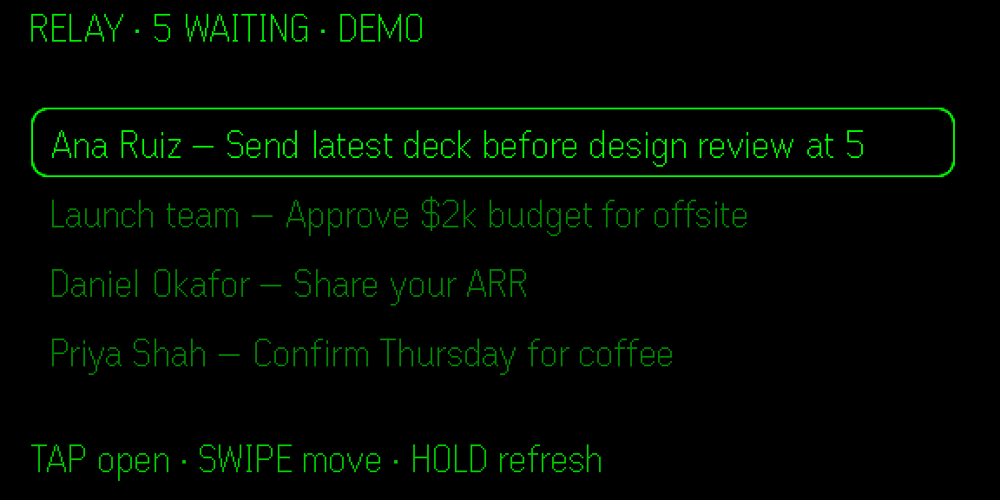 | 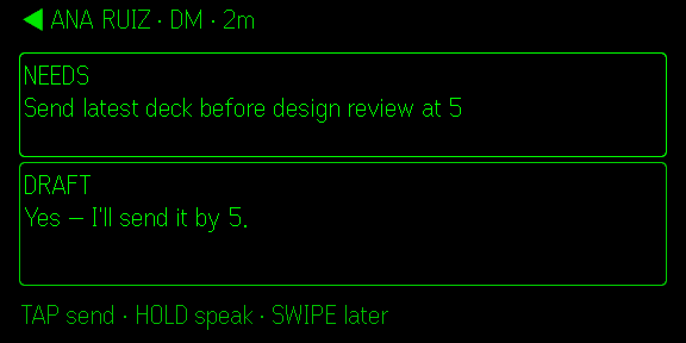 | 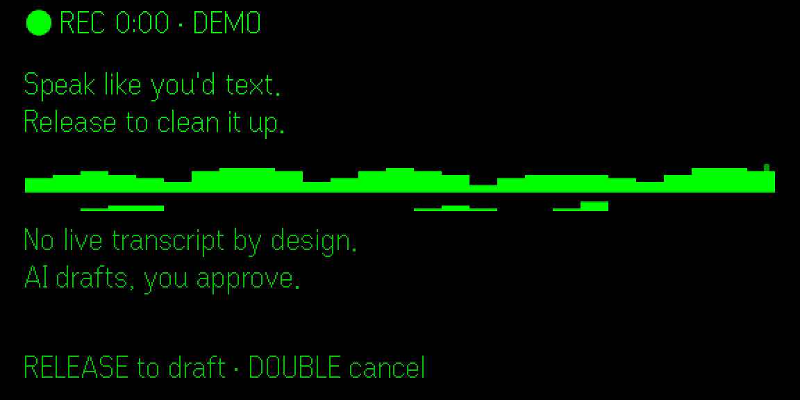 |
| **Draft** | **Sent** | **Digest** |
| 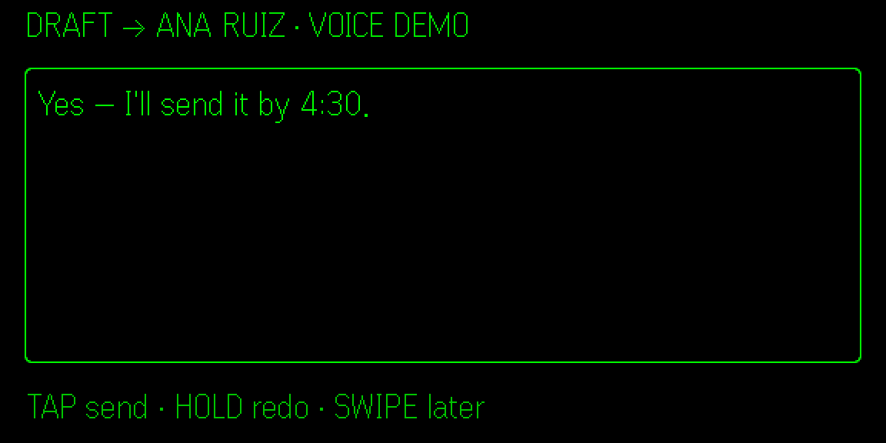 | 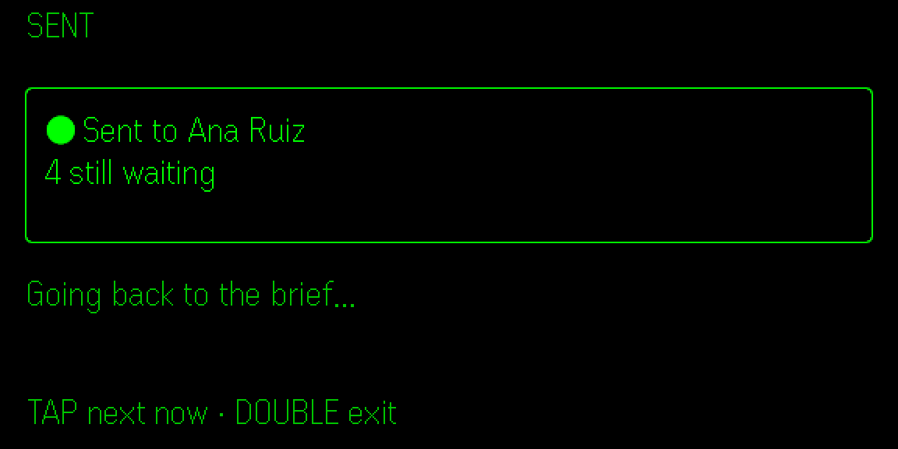 | 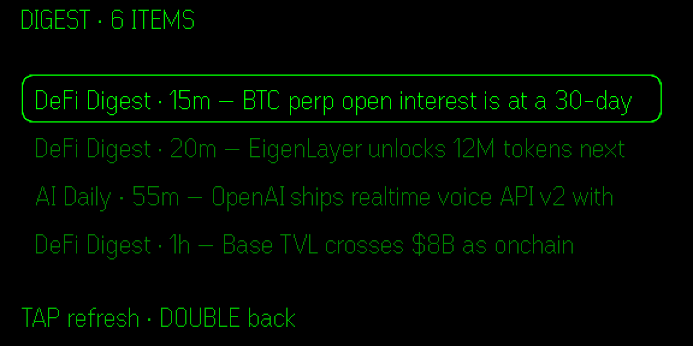 |

| Pair on the glasses | Pair on the phone |
|---|---|
| 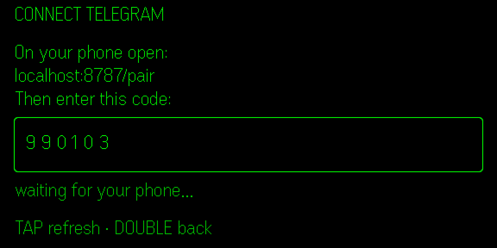 | 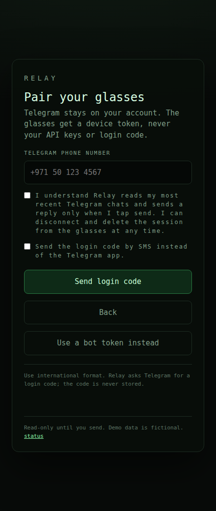 |

| A sensitive ask: **CHECK** | Review before send |
|---|---|
| 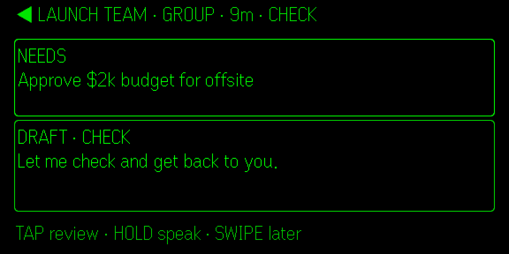 | 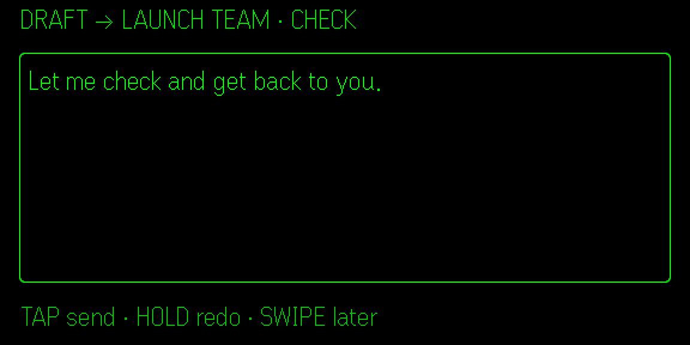 |

Screenshots are real framebuffer captures from the Even Hub simulator (`npm run test:e2e` regenerates the display screenshots).

### Why this is not another Telegram viewer

The track is crowded with read/digest/draft apps. Relay is built around the **decision and the write**:

| | Typical G2 Telegram app | Relay |
|---|---|---|
| What it shows | unread messages / digest | only **open loops**: someone is waiting, or a position is at risk |
| Read | message text | extracted **ask** + context |
| Write | copy a draft | hold ring → voice → cleaned draft → **one tap send** |
| Safety | sends whatever AI writes | clear/possible/sensitive; **no default commitments**; review gate; uncertainty preserved |
| Second surface | — | **Hyperliquid paper position** with voice/tap de-risk and confirm |
| Evidence | demo | 58 tests, simulator E2E, packaged `.ehpk`, live Bot API proof |

## Second track · Crypto & DeFi (Hyperliquid)

**Not a trading terminal. A risk layer for the open loops you already have.**

A Telegram channel posts a BTC signal. Relay shows the live Hyperliquid mark/funding/open interest and your **paper** BTC-PERP position. Hold the ring and say **“de-risk 25”** (or tap), confirm on the glasses, and the paper position is reduced — liquidation distance moves away. No exchange keys. No real funds. No order leaves the device.

| Markets | Confirm | Risk cut |
|---|---|---|
| 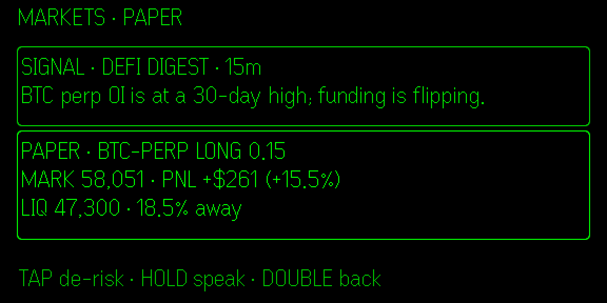 | 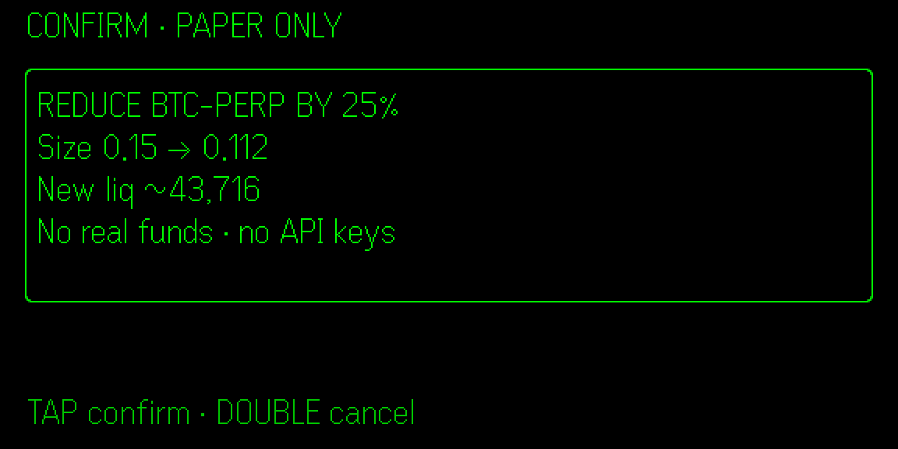 |  |

This is a genuine cross-track flow: Telegram (channel signal) + Hyperliquid (live public market context + paper order). That is why Relay enters **Crypto & DeFi** as a second track without becoming a different product.

We chose Crypto & DeFi over Exchanges & Stocks deliberately: Hyperliquid's public read path and paper positions need **no API keys or custody**, and the “signal → risk → confirm” flow matches Relay's attention thesis. A Binance/OKX terminal would be a different app and a much more crowded trading-terminal category.

---

## Quick start (demo mode, no credentials)

Requirements: Node.js 20.17+ and the Even Hub simulator. Demo mode ships a **fictional inbox** and needs **no Telegram, LLM or STT keys**.

```bash
npm install

# terminal 1 — Relay backend (port 8787)
npm start

# terminal 2 — glasses app (Vite, port 5199)
npm run dev

# terminal 3 — simulator
evenhub-simulator "http://127.0.0.1:5199/?fresh=1"
```

Tap the simulator's glasses display (or use its Click control) to open the top loop. Hold the on-screen long-press control to speak; the demo uses a scripted utterance because CI has no microphone. Send with a tap.

The app **auto-creates a demo account on first launch**. `?fresh=1` discards the stored token and starts a clean fictional inbox. A `DEMO` badge is always visible on the display, and the inbox contains invented people and messages.

### One-command demo (Linux/CI, headless X)

```bash
npm run demo        # starts backend + preview + simulator on Xvfb
npm run test:e2e    # drives the full journey and asserts the framebuffer
```

`npm run demo` is a convenience for the headless environment used to build this repo. On macOS/Windows, use the three-terminal flow above.

### Packaged build

```bash
npm run pack        # → app/relay.ehpk
```

The committed `.ehpk` was built against SDK `0.0.16` and stamped `min_app_version 2.2.10`.

---

## Real Telegram

Relay uses **Telegram MTProto with a user session**, not a Bot API toy. A bot can only see messages sent to the bot; a real reply layer has to see the chats where people actually wait on you.

1. Create an application at [my.telegram.org/apps](https://my.telegram.org/apps) and get `api_id` / `api_hash`.
2. Configure the backend:

```bash
cp .env.example .env
# .env
TG_API_ID=123456
TG_API_HASH=...
SESSION_KEY=$(openssl rand -hex 32)
PUBLIC_URL=http://localhost:8787
```

3. Restart `npm start`.
4. On the glasses: open the contextual menu → **Connect Telegram**. Relay shows a 6-digit code.
5. On the phone: open `PUBLIC_URL/pair`, enter the code, then your phone number, the Telegram login code, and 2FA if enabled.
6. Relay encrypts the resulting `StringSession` with AES-256-GCM, syncs the 12 most recent dialogs (7 messages each), and replaces the demo inbox. Replies go back through `messages.sendMessage`; read receipts are best-effort.

> **Live status (Nov 24, 2026):** the **Bot API mode is live-verified** — a real bot (`@RelayTest2026bot`) was paired, a real request was rendered as a loop, a reply was sent, and the token was revoked (evidence below). The **MTProto DM** adapter is implemented and covered by mocked GramJS tests, but live DM login is still pending: Telegram returned `auth.SentCodeTypeApp` with `nextType: null` for the test number, so the code only goes to an existing app session and SMS is unavailable. Use a test account and respect Telegram's terms and rate limits.

### Live Bot API proof

| Live bot inbox | Real send | Revoked → demo restored |
|---|---|---|
| 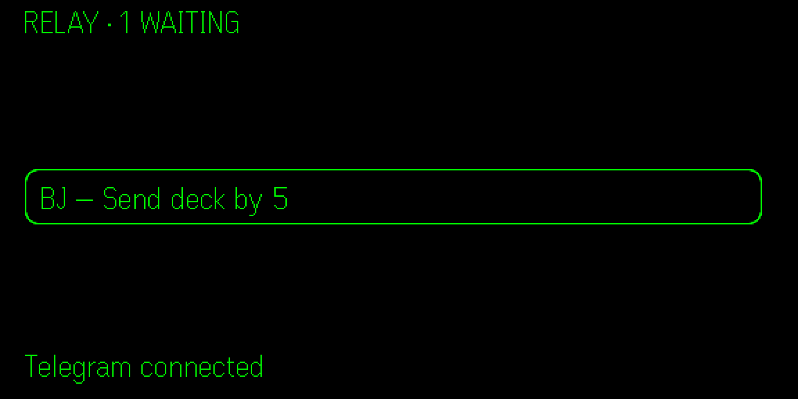 | 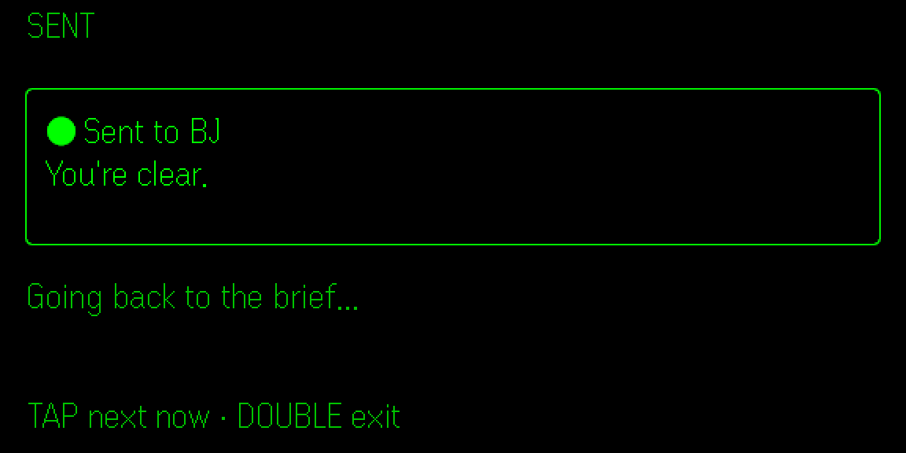 | 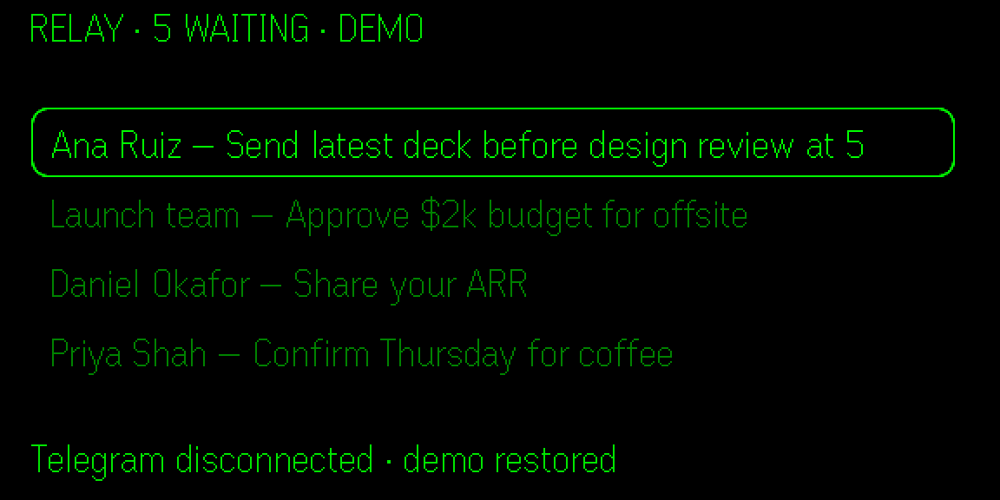 |

The bot saw `/start` + *“Can you send me the deck by 5?”*; Relay synced 1 thread / 2 messages, rendered `BJ — Send deck by 5`, sent **“Yes — I'll send it by 5.”** through `sendMessage` (`RELAY SENT BJ remaining=0`), then **Disconnect Telegram** removed the stored token (`botTokenEnc` 1 → 0) and restored the demo. Full log: `docs/LIVE_TELEGRAM.md`.

### Hardware readiness

The simulator is the **official submission path** — the rules say no glasses are
needed. The packaged `.ehpk` also runs without a backend: it falls back to
`OFFLINE DEMO` with the fictional inbox. That exact fallback was tested:

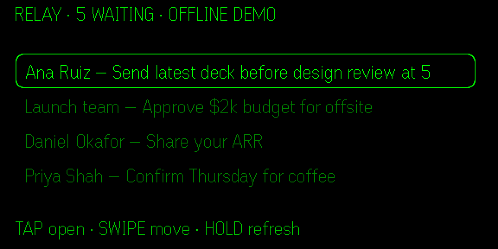

If you have a G2, use `docs/HARDWARE_TEST.md` for the install, gesture, lock/relaunch,
microphone, and beta checklist. It includes the offline smoke test and the
LAN-backed live build (`VITE_API_URL=...`, whitelist, repack).

### Bot mode (live Bot API, no phone code)

For team/community bots — or when the Telegram app's login code is inaccessible — Relay can connect a **Bot API** token instead:

1. Create a throwaway bot with **@BotFather** (`/newbot`), send it a message such as *"Can you send me the deck by 5?"*.
2. On `/pair`, choose **Use a bot token instead**, paste the token, and connect.
3. The bot's visible chats appear as loops; replies are sent through `sendMessage`.

Bots only see messages addressed to them / groups they can access — **never personal DMs**. This is a real live read/write path, but a weaker one than the MTProto user session. Pairing API: `POST /api/pair/:code/bot` with `{token}`.

### Phone build

The WebView must reach a server it can route to. Set the API origin at build time and add it to the manifest whitelist:

```bash
VITE_API_URL=http://192.168.1.20:8787 npm run build
```

Add `http://192.168.1.20:8787` (or your HTTPS origin) to `app/app.json` → `network.whitelist`, then `npm run pack`. Set `PUBLIC_URL` to the same origin so the pair code shows the right page. Production must use HTTPS.

---

## Optional AI and speech

Everything degrades gracefully; the demo never depends on a key.

| Capability | Configure | Without it |
|---|---|---|
| Ask extraction | built in (deterministic) | always on |
| Draft rewriting | `LLM_API_KEY`, `LLM_BASE_URL`, `LLM_MODEL` (OpenAI-compatible) | deterministic templates + intent rewriting |
| Speech-to-text | `OPENAI_API_KEY` / `STT_MODEL`, or `WHISPER_BIN` + `WHISPER_MODEL` (whisper.cpp) | demo voice utterance in demo mode; explicit error in live mode |

The server receives raw **16 kHz signed 16-bit mono PCM** from the glasses mic, wraps it in WAV, and sends it to the configured STT provider. Audio is not persisted. LLM prompts are in `server/src/services/ai.ts`; the deterministic drafter in `shared/loops.ts` is the safety net.

---

## Architecture

```
┌──────────────────────────────┐         ┌──────────────────────────────┐
│ Even G2                      │  BLE    │ Even Realities App (phone)   │
│ 576×288, mics, touch, R1     │◄───────►│ WebView: Vite + TS + SDK     │
└──────────────────────────────┘         └──────────────┬───────────────┘
                                                       │ HTTPS, whitelisted
                                                       ▼
                                        ┌──────────────────────────────┐
                                        │ Relay backend (Node + TS)    │
                                        │  pairing · ranking · sending │
                                        │  AI adapter · STT adapter    │
                                        └──────┬───────────────┬───────┘
                                               ▼               ▼
                                        Telegram MTProto   LLM / Whisper
                                        (user session)     (optional)
```

- **App** (`app/`): Vite + TypeScript, no UI framework. The display is 3–5 text containers or one native list, all laid out for 576×288. `views.ts` is pure and tested against the firmware's container contract.
- **Backend** (`server/`): Express, a JSON repository behind a `Store` interface, pairing codes, hashed device tokens, AES-GCM session encryption, rate limiting, and the Telegram/LLM/STT adapters.
- **Shared domain** (`shared/`): types, deterministic ask extraction, urgency, ranking, draft templates, demo seed. Used by both the server and the offline fallback in the app, so the product behaves the same with or without a backend.

### Why MTProto instead of Bot API

| | Bot API | MTProto user session (Relay) |
|---|---|---|
| See messages in your DMs/groups | No (only bot-addressed) | Yes |
| Reply as you | Bot identity | You |
| Login UX | Bot token | Phone + code + 2FA |
| ToS / risk | Simple | User-account automation; treat as a client |

### Data model

`Account → Thread(s) → Message(s)`. An **open loop** is derived, not stored: the last message is inbound, the deterministic (or LLM) extractor finds a real ask, and the score is `urgency × 1000 + VIP × 100 + freshness + question`. Sending an outbound message closes the loop automatically, so the brief can never drift from the chat state.

---

## API

| Method | Path | Purpose |
|---|---|---|
| `POST` | `/api/session/demo` | Create a fictional inbox + device token |
| `GET` | `/api/inbox` | Ranked open loops, snoozed count, channel count |
| `GET` | `/api/loop/:id` | Ask, draft, recent messages |
| `POST` | `/api/loop/:id/draft` | Rewrite a draft with an optional spoken intent |
| `POST` | `/api/loop/:id/send` | Send via Telegram (or demo store), close loop |
| `POST` | `/api/loop/:id/snooze` | Hide for N minutes, count in `LATER` |
| `POST` | `/api/loop/:id/vip` | Promote a sender in the ranking |
| `POST` | `/api/loop/:id/mute` | Drop a thread from the brief |
| `GET` | `/api/digest` | Channel headlines, no interruptions |
| `GET` | `/api/market` | Live Hyperliquid context + paper position |
| `POST` | `/api/market/de-risk` | Reduce/close the paper position; confirm-only |
| `GET` | `/api/stats` | Cleared loops, sensitive clears, open→send latency |
| `POST` | `/api/session/revoke` | Disconnect Telegram, delete the session, restore demo |
| `POST` | `/api/transcribe` | PCM → text (or explicit demo utterance) |
| `POST` | `/api/pair/new` | 6-digit code, 10-minute TTL |
| `GET` | `/api/pair/:code` | Poll pairing status |
| `POST` | `/api/pair/:code/telegram/start` | Send Telegram login code |
| `POST` | `/api/pair/:code/telegram/verify` | Verify code/2FA, attach session |
| `POST` | `/api/pair/:code/bot` | Attach a Bot API token and sync its visible chats |
| `GET` | `/api/export` | Export the account's threads/messages |
| `DELETE` | `/api/account` | Delete account, tokens, messages, sessions |
| `GET` | `/health` | Feature flags + store stats |
| `GET` | `/pair` | Phone pairing page |

Auth is `Authorization: Bearer <device token>`; only the SHA-256 hash is stored. CORS defaults to `*` for the simulator; set `CORS_ORIGIN` to your app origin in production.

---

## Safety and privacy

- **No default commitments.** Clear/possible/sensitive classification (above); sensitive and hedged asks get a neutral holding reply and a review step. The user's spoken uncertainty is preserved. There is no auto-send.
- **No real money, no exchange keys, no orders.** The Hyperliquid surface is read-only public data + a **PAPER** position; de-risk is a local paper action with an explicit confirm. No financial advice. Demo data is fictional.
- **No secrets in the client.** The `.ehpk` contains no keys; all provider calls are server-side.
- **Explicit consent.** The phone pairing page requires a checkbox acknowledging that Relay reads recent chats and sends only approved replies.
- **Revocation on the glasses.** On the connected pair screen, **hold to revoke**: the Telegram session is disconnected and deleted, and the fictional demo is restored. `DELETE /api/account` removes everything; `GET /api/export` exports it.
- **Per-chat control.** Mute any thread from its menu; VIP promotes a sender. A full per-chat read allowlist is the next privacy step (see limitations).
- **Minimal reads.** Only the 12 most recent dialogs and 7 messages each are snapshotted; content lives in a local JSON store for the demo.
- **Sessions encrypted at rest** with AES-256-GCM (`SESSION_KEY`); device tokens are hashed. Login codes and session strings are never logged (the request log contains method/path/status only).
- **Pair codes** are 6 digits, single-use, 10-minute TTL, rate-limited per IP.
- **Respect the room.** Message content is only rendered on the user's own glasses; no analytics, no third-party trackers.

---

## Metrics

`npm run metrics` creates a demo account, opens Ana's loop, waits 800 ms, drafts from a spoken intent, sends, and reads `/api/stats`.

```
measurement: openedToSentMs 1206 · draft "Yes — I'll send it by 4:30." · remaining 4
stats:       cleared 1 · sensitiveCleared 0 · avgResolveMs 1108 · openLoops 4
```

The metric that matters is **time to clear a loop**, not messages read. The server starts the clock when the loop is opened (`viewedAt`) and records `resolveMs` when the reply is sent; sensitive clears are counted separately. The sample includes a deliberate 800 ms pause and excludes the user's speaking time. Next: a "not an ask" feedback action to measure false positives.

---

## Tests and evidence

```bash
npm test          # 51 unit + integration tests
npm run test:e2e  # real simulator journey + screenshots
```

The suite covers:

- ask extraction, **clear/possible/sensitive classification**, neutral defaults, uncertainty preservation, urgency, ranking, drafts, digest, WAV wrapper (`server/test/domain.test.ts`)
- the full HTTP flow including auth, validation, pairing, **VIP/mute**, **session revocation**, **resolve-time stats**, reset, export, delete (`server/test/api.test.ts`)
- every screen's container contract, canvas bounds, overlaps, text fit, capture count, and the **CHECK/MAYBE review gates** (`app/test/views.test.ts`)
- the LLM and STT adapters against fake OpenAI-compatible servers, including WAV upload and response cleaning (`server/test/adapters.test.ts`)
- the **Telegram MTProto adapter** against a fake GramJS client: login, snapshot mapping, send, and 2FA without re-sending the code (`server/test/telegram.test.ts`)
- the **Telegram Bot API adapter** against a fake Bot API server: update mapping, private-chat loop extraction, send, pairing, and revoke (`server/test/bot.test.ts`, `server/test/api.test.ts`). Live MTProto DMs still need an accessible app code — see `docs/LIVE_TELEGRAM.md`.

`npm run test:e2e` boots the backend, preview, and simulator, then drives tap → detail → long-press → release → draft → send → digest → pair, plus a **sensitive-loop gate**: tapping the budget ask must open review and must **not** emit a send. It asserts app log markers, non-blank framebuffers, distinct screen hashes, and **no console errors**. Latest run:

```
PASS · full journey
  brief lit=6280 · detail lit=5644 · draft lit=3467 · sent lit=3449
  market leg: RELAY MARKET → RELAY DERISK 25
  pair code issued · screenshots in docs/
```

It also regenerates `docs/*.png` from the real framebuffer.

### What was built during the hackathon

Everything in this repository was written on **Nov 23–24, 2026**, except the pre-existing pieces listed here. No code was copied from other submissions.

Pre-existing: Even Hub SDK `0.0.16`, CLI `0.2.0`, simulator `0.9.5`; the minimal template pattern; Vite, Express, GramJS, Telegram/OpenAI APIs.

Built: the product thesis, the twelve screens, the ranking/extraction/drafting domain, the backend, pairing, the Telegram MTProto/Bot API/LLM/STT/Hyperliquid adapters, the paper-position layer, the demo seed, the offline fallback, the tests, the E2E harness, the live bot proof, the screenshots, the demo video, and the packaged `.ehpk`.

---

## Feature requests for the Even Hub team

1. **A background complication/widget** for "3 waiting" so the value exists before the app is opened.
2. **On-device STT or native dictation** so a voice reply doesn't need a server round-trip.
3. **Two-line list items / per-item styling** (sender + ask in one row) — the current one-line list forces a choice between context and the ask.
4. **First-party Telegram account linking** (an OAuth-style flow) instead of asking users to create MTProto API credentials.
5. **Ring vs temple semantics** (primary vs secondary actions) plus haptics, so a glance-and-tap app can stay silent and eyes-free.

---

## Repository layout

```
app/                 Even Hub plugin (Vite + TypeScript + SDK)
  src/views.ts       pure screen models + firmware contract checks
  src/ui.ts          SDK container renderer (text + native list + menu)
  src/main.ts        state machine, gestures, voice flow
  src/api.ts         backend client + offline demo fallback
  src/audio.ts       PCM capture, RMS waveform, WAV/base64
  app.json           manifest (network + g2-microphone)
  relay.ehpk         packaged build
server/              Express backend
  src/services/      Telegram MTProto + Bot API, LLM, STT
  src/pages/pair.ts  phone pairing page
  src/store.ts       repository, pairing, tokens
  test/              domain + HTTP integration tests
shared/              types, extraction/ranking/drafts, demo seed
tools/               simulator + server orchestration, E2E, video
docs/                framebuffer screenshots + demo video
RESEARCH.md          hackathon analysis, idea scoring, product rationale
SUBMISSION.md        DoraHacks copy + checklist
PITCH.md             3-minute pitch and Q&A
```

## Limitations / next

- **MTProto DM live login** is pending an accessible app session/code. Telegram returns `SentCodeTypeApp` with no SMS fallback for the test number; the adapter is mocked-tested. To force SMS, log out every Telegram app session for the number (or use a second number with no active app); checklist: `docs/LIVE_TELEGRAM.md`. **Bot API mode is live-verified** for bot/community inboxes (not personal DMs).
- **Per-chat read allowlist:** mute and VIP are implemented, but Relay still snapshots the 12 most recent dialogs rather than asking per chat.
- **Paper market mode:** Hyperliquid context is live/read-only, but de-risk is a local paper action. Real execution would need a testnet API wallet, confirmation, and more custody/security work — deliberately out of scope.
- **Physical G2/beta test:** not run here (no hardware). The simulator is accepted for submission; the offline `.ehpk` fallback and `docs/HARDWARE_TEST.md` cover the first hardware pass.
- Simulator ≠ hardware: font, greyscale and image pacing need a G2 check.
- Android may suspend the WebView; the app persists its token and re-derives the brief on relaunch, but it has not been beta-tested on a physical phone yet.
- Telegram entity resolution scans up to 100 dialogs on send; a production build should cache access hashes.
- The JSON store is single-node. Production needs Postgres, a job queue for sync, and per-user rate limits.
- Background push is impossible on the current platform surface; the "waiting" count needs a widget/complication (request #1).

## License

MIT. Demo names and messages are fictional.

---

**Built for the Even Realities × TVM Ventures × Daos Hub "Heads Up" hackathon, Nov 2026.**

Repo: [github.com/bolajiev/relay-g2](https://github.com/bolajiev/relay-g2)
