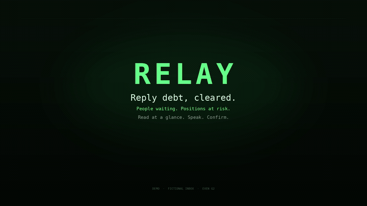

# Relay — team one-pager

**One line:** Relay is a decision layer for Even G2 — **people waiting on Telegram, positions at risk on Hyperliquid.** Read, speak, confirm.

**Repo:** https://github.com/bolajiev/relay-g2  
**Demo (66s, voice-over + captions):** https://github.com/bolajiev/relay-g2/releases/download/v0.1.0/relay-demo.mp4  
**Deadline:** Nov 29, 19:59 UTC · **3 days left** (as of Nov 26)

<a href="https://github.com/bolajiev/relay-g2/releases/download/v0.1.0/relay-demo.mp4">
  
</a>

*The inline GIF is silent; click it for the MP4 with voice-over and controls.*

---

## What we are submitting

| | |
|---|---|
| **Primary track** | **01 · Messaging & News** |
| **Second track** | **02 · Crypto & DeFi** (Hyperliquid paper risk) |
| **Special entry** | **Best Telegram integration** |
| **Build** | One repo, one 66s demo, one `.ehpk` — no duplicate submissions |

The rules allow up to **2 tracks** when one app genuinely connects apps from both; Telegram channel signal + Hyperliquid is exactly the example they give.

## The product in 20 seconds

1. **Brief:** `RELAY · 3 WAITING` — only threads where someone needs an answer.
2. **Tap:** `Ana — Send the deck before the design review at 5` + a draft.
3. **Hold the ring:** “yeah tell her I’ll send it by 4:30.”
4. **Release:** `Yes — I’ll send it by 4:30.`
5. **Tap:** sent. The loop closes; the next one appears.

**Second surface:** a DeFi Digest Telegram signal → live Hyperliquid mark/funding/OI → a **PAPER** BTC-PERP position → hold the ring “de-risk 25” → `CONFIRM · PAPER ONLY` → risk cut, liquidation moves away. No exchange keys, no real funds, no orders.

## Status

| Area | State |
|---|---|
| Tests | **58/58 pass** |
| CI | **Green** on the final commit |
| Simulator E2E | **Pass** — Telegram loop + markets + sensitive review + pair |
| Live Telegram | **Bot API read/send/revoke verified** with a test bot |
| MTProto DMs | Adapter mocked-tested; live auth blocked by app-only code (`SentCodeTypeApp`, no SMS) |
| Hyperliquid | **Live public market context + paper de-risk** verified |
| Hardware | Simulator accepted; offline `.ehpk` verified |
| Demo mode | Works with **no credentials**; fictional inbox |
| Security | Bot token revoked after the test; demo runs with no credentials |

## One link for each thing

- **Repo:** https://github.com/bolajiev/relay-g2
- **66s demo:** https://github.com/bolajiev/relay-g2/releases/download/v0.1.0/relay-demo.mp4
- **Packaged `.ehpk`:** https://github.com/bolajiev/relay-g2/releases/download/v0.1.0/relay.ehpk
- **Screens:** [`brief`](docs/brief.png) · [`draft`](docs/draft.png) · [`markets`](docs/market.png) · [`confirm`](docs/market-confirm.png) · [`risk cut`](docs/market-done.png)
- **Full README:** [README.md](README.md)

## Submit — 3 steps (team lead)

1. Open **https://dorahacks.io/hackathon/even-realities/detail** → **Submit Build**.
2. Use the private submission copy; select **01 Messaging & News** primary + **02 Crypto & DeFi** second; add **Best Telegram integration**.
3. If the form requires a video URL, use the release MP4 link above (or upload it to YouTube/Loom if it insists on a player).

**Do not** create a second repo/project; that splits the production-readiness score.

## Open items

- [ ] **DoraHacks submit** — needs the team lead’s login.
- [ ] Optional: MTProto DM live test with an account whose app code is readable.
- [ ] Optional: physical G2/beta pass.

## Copy for the team chat

```text
Relay — Even G2 Heads Up submission
Telegram reply debt + Hyperliquid paper risk. One project, two tracks + Best Telegram.
66s demo: https://github.com/bolajiev/relay-g2/releases/download/v0.1.0/relay-demo.mp4
Team brief: https://github.com/bolajiev/relay-g2/blob/main/TEAM.md
Repo: https://github.com/bolajiev/relay-g2
Deadline: Nov 29, 19:59 UTC. Submit via DoraHacks; needs a login.
```
